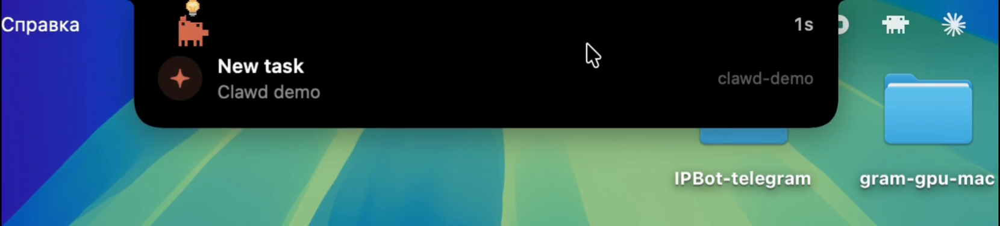

<div align="center">

**English** · [Русский](README.ru.md)


# Claude Notch

**[Claude Code](https://claude.com/claude-code) in your MacBook's notch, like the Dynamic Island on an iPhone.**<br>
See what Claude is doing, how long it's been at it and when it needs you, and answer it right there.<br>
And Clawd lives in the notch.


<table>
<tr>
<td align="center" valign="top"><br><b>Coffee</b></td>
<td align="center" valign="top"><br><b>Music</b></td>
<td align="center" valign="top"><br><b>Magic</b></td>
<td align="center" valign="top"><br><b>Pancakes</b></td>
</tr>
</table>

</div>

## Install

You need macOS 14 or later and Claude Code, in a terminal or in the Claude app.

1. Download **ClaudeNotch-….dmg** from the [latest release](https://github.com/CraftStick/ClaudeNotch/releases/latest) and open Claude Notch right in it. Apple hasn't notarized it, so the first time macOS won't: click **Done**, then **System Settings → Privacy & Security → Open Anyway**.
2. Click **Move**: it copies itself to Applications and opens from there.
3. When it asks to connect to Claude Code, click **Connect**. It adds its hooks to `~/.claude/settings.json` and keeps the original next to it.

**Or with [Homebrew](https://brew.sh):**

```bash
brew install craftstick/tap/claude-notch
```

Then open Claude Notch from Applications (the first time: **Done**, then **System Settings → Privacy & Security → Open Anyway**) and click **Connect**. Update with `brew upgrade claude-notch`.

**Update:** open the new one from its disk image and click **Move**: it quits the old one and takes its place.<br>
**Uninstall:** move the app to the Trash and click **Remove All**: its hooks, login item, settings and data go with it.

<details>
<summary>Build from source</summary>

```bash
xcode-select --install   # Apple's command line tools, if you don't have them yet
git clone https://github.com/CraftStick/ClaudeNotch.git ~/ClaudeNotch
cd ~/ClaudeNotch && ./install.sh
```

`install.sh` builds the app into `/Applications` and adds the hooks. Update with `git pull && ./install.sh`, remove with `./uninstall.sh`, run the tests with `swift test`.

</details>

## What it does

- **Status in the notch.** Clawd on the left, the task's time on the right, a counter when several sessions are at work. The notch opens for what matters: a new task, a failure, Claude waiting for you, done.
- **Details on hover.** The task, what Claude is doing and why, its plan, subagents, recent actions, tokens and context, other sessions. A click brings forward the terminal tab or app the session runs in.
- **Answers from the notch.** Allow or deny a permission request (⌃⌥⌘Y / ⌃⌥⌘N, or **Always**), and pick the answers to Claude's questions (⌃⌥⌘1…4).
- **Clawd.** He types while Claude works, thinks, waves when it needs you, hops when it's done and dozes while he rests; he turns detective while Claude searches, packs papers into a box while it compacts and launches a rocket after a push. With **Clawd stays in the notch** on, he lives there for good, with pastimes of his own. [All his animations →](docs/clawd/README.md)
- A sound when Claude is done or waiting for you, a glowing rim, English and Russian, your own shortcuts, an update check if you want one. All of it in the settings: Clawd's menu in the menu bar → **Settings…** (⌘,).

<p align="center"> </p>

## How it works

Claude Code runs a tiny hook on every event, which hands it to the app over a local socket and, for a permission request or a question, hands your answer back. The app also reads the session files in `~/.claude/projects`, to notice Esc and count tokens.

Everything stays on your Mac, with no network. The one exception is a check for updates on GitHub once a day, and only if you switch it on in the settings. While the notch can't be seen (the display asleep, the screen locked), the app doesn't wake up at all; while Claude works, it takes about 1–2% of one core.

## Troubleshooting

- **The notch doesn't react:** check that **Connected to Claude Code** is on in the settings. Sessions opened before may need a restart.
- **A click opens the terminal but not the session's tab:** allow Claude Notch in System Settings → Privacy & Security → Automation.
- **What reaches the app:** `tail -f ~/Library/Application\ Support/ClaudeNotch/events.log`.

## Ideas

Have an idea for what to add, or found something that doesn't work? [Open an issue](https://github.com/CraftStick/ClaudeNotch/issues/new) and tell me about it.

## About Clawd

Clawd is Anthropic's character, and his sprites aren't in this repository: the app reads them from the Claude app on your Mac, and draws a simpler Clawd if it isn't there. This project isn't affiliated with or endorsed by Anthropic.

[PolyForm Strict License 1.0.0](LICENSE), for every version, 0.1.0 to 0.1.6 included: you may use Claude Notch for any noncommercial purpose and share unchanged copies of it for free, but not make changes or new works based on it.

## Demo

<a href="docs/demo.mp4"></a><br>
<a href="docs/demo.mp4"><b>▶ Watch the 2-minute demo: every reaction of Clawd's in the notch</b></a>
