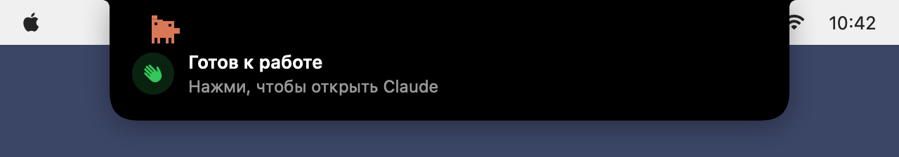

<div align="center">

[English](README.md) · **Русский**


# Claude Notch

**Статус [Claude Code](https://claude.com/claude-code) в чёлке MacBook — как Dynamic Island на iPhone.**<br>
Что агент делает прямо сейчас, сколько идёт задача, когда он ждёт тебя.<br>
Разрешения — кнопками прямо в чёлке. А рядом живёт Clawd.


</div>

## Установка

Нужны **macOS 14 или новее** и **Claude Code** (в терминале или во вкладке Code приложения Claude).

**1.** Поставь инструменты разработчика Apple, если их ещё нет (откроется окно установки; если уже стоят — команда так и скажет):

```bash
xcode-select --install
```

**2.** Скачай и установи Claude Notch:

```bash
git clone https://github.com/CraftStick/ClaudeNotch.git
cd ClaudeNotch
./install.sh
```

Всё. Clawd поздоровается из чёлки и устроится в строке меню, а чёлка оживёт, как только Claude Code возьмётся за задачу.

<details>
<summary>Без git — скачать ZIP</summary>

```bash
curl -L -o ClaudeNotch.zip https://github.com/CraftStick/ClaudeNotch/archive/refs/heads/main.zip
unzip -q ClaudeNotch.zip && cd ClaudeNotch-main
chmod +x *.sh && ./install.sh
```

</details>

<details>
<summary>Что делает <code>install.sh</code></summary>

1. Собирает приложение из исходников (`build.sh`) в `~/Applications/ClaudeNotch.app` и запускает его. Сборка локальная, поэтому macOS не показывает предупреждений Gatekeeper.
2. Добавляет хуки в `~/.claude/settings.json` (`install-hooks.sh`). Остальные настройки и чужие хуки не трогаются, первый запуск сохраняет исходный файл как `settings.json.bak-claudenotch` (следующие его не трогают), повторный запуск ничего не дублирует.
3. Приложение само включает автозапуск при входе в систему (выключается в меню).

</details>

**Обновление:**

```bash
cd ClaudeNotch && git pull && ./install.sh
```

**Удаление** (хуки, автозапуск, приложение и его данные):

```bash
cd ClaudeNotch && ./uninstall.sh
```

## Что умеет

### Статус в чёлке

Слева от чёлки — Clawd, справа — время задачи. На каждом действии чёлка на пару секунд раскрывается: «Выполняет команду», «Читает файл», «Редактирует», «Ищет в коде», «Браузер»… с деталями. Работает с несколькими сессиями сразу: рядом с таймером счётчик сессий в работе.

А ещё чёлка пишет, о чём Claude думает: «Думает…» с сутью его мыслей, а под каждым действием — зачем он это делает («Редактирует · auth.ts — Поправлю проверку токена»). Это берётся из того, что Claude пишет между действиями; у команды вместо самой команды показывается её описание.

Если открыть само приложение (при входе в систему или ещё раз из Finder или Spotlight), Clawd подпрыгнет и помашет из чёлки: «Готов к работе». Клик по ней открывает Claude, или то приложение, где Claude Code запускался в последний раз.

<p align="center"></p>

### Подробности при наведении

Наведи курсор на чёлку — раскроется карточка: задача, что происходит сейчас (с описанием и полной командой), субагенты, последние действия с размером правок, другие сессии, а внизу — правки, токены и заполненность контекста за ход. Клик по чёлке открывает приложение, в котором идёт сессия (Terminal, iTerm, VS Code, Cursor, приложение Claude…).

<p align="center"></p>

### Разрешения из чёлки

Когда Claude Code просит разрешения, в чёлке появляются кнопки **Разрешить** (⌃⌥⌘Y), **Запретить** (⌃⌥⌘N) и **Всегда** — добавить правило, которое предложил Claude Code, чтобы больше не спрашивал. Горячие клавиши работают только пока висит запрос, не требуют разрешений macOS и не отнимают у других приложений привычные сочетания вроде ⌘N. В приложении Claude и расширениях IDE обычное окно разрешения тоже появляется, и засчитывается тот ответ, что пришёл первым. В терминале чёлка ждёт 20 секунд, а потом возвращает вопрос обычному диалогу (или сразу — кнопкой «В приложении»).

<p align="center"></p>

### Clawd

Clawd живёт в чёлке и показывает, чем занят Claude: достаёт ноутбук и печатает, пока Claude работает, садится подумать, пересаживается за компьютер на долгих командах, машет, когда Claude ждёт тебя, радостно подпрыгивает, когда всё готово, и дремлет, пока отдыхает.

<p align="center">


</p>

**[Все анимации Clawd и когда они играют →](docs/clawd/README.ru.md)**

Каждый раз, когда Claude закончил или ждёт ответа, звучит сигнал (выключается в меню).

### Язык

Интерфейс на русском или английском — по языку системы. Переключить: значок Clawd → **Язык**.

## Как это устроено

```
Claude Code ──хук (JSON в stdin)──▶ claude-notch-hook ──Unix-сокет──▶ ClaudeNotch.app
                  ◀── решение (только для запроса разрешения) ──┘
```

- **`Sources/Hook/main.swift`** — крошечный бинарник, который Claude Code запускает на каждое событие. Пересылает JSON в приложение и печатает ответ, если он есть. Всегда завершается с кодом 0 и молча, даже если приложение не запущено, — Claude Code он не мешает.
- **`Store.swift`** — превращает события хуков в состояние чёлки и отвечает на запросы разрешений.
- **`NotchView.swift`**, **`DetailsCard.swift`** — интерфейс: форма вокруг чёлки, раскрытые режимы, карточки.
- **`ClawdAnimation.swift`**, **`Clawd.swift`** — анимации Clawd ([все они](docs/clawd/README.ru.md)).
- **`TranscriptWatcher.swift`** — следит за файлом сессии: на Esc Claude Code не вызывает хуков, а ещё там расход токенов.
- **`AppFocus.swift`**, **`HotKeys.swift`**, **`SocketServer.swift`** — клик по чёлке, ⌃⌥⌘Y/⌃⌥⌘N, сокет.

**Приватность.** Всё работает локально, без сети. Хук отправляет события только в сокет `~/Library/Application Support/ClaudeNotch/notch.sock`, доступный лишь твоему пользователю. Приложение читает файлы сессий в `~/.claude/projects` только чтобы заметить Esc, посчитать токены и показать, о чём думает Claude.

## Если что-то не работает

- **Чёлка не реагирует.** Проверь, что приложение запущено (`pgrep -x ClaudeNotch`) и хуки на месте (`grep -c claude-notch-hook ~/.claude/settings.json`). Уже открытые сессии Claude Code иногда подхватывают новые хуки только после перезапуска.
- **Что доходит до приложения** — видно в журнале: `tail -f ~/Library/Application\ Support/ClaudeNotch/events.log`.
- **Заполненность контекста** считается от 200K токенов, а если сессия заняла больше — от 1M: размер окна Claude Code в файл сессии не пишет.
- **Монитор без чёлки** — рисуется «виртуальная» чёлка в строке меню.

## Про Clawd

Clawd — персонаж Anthropic, и его спрайтов в исходниках нет. При запуске приложение читает их из установленного у тебя Claude.app (они лежат в его `app.asar`, в пасхалке Clawd Quest). Если Claude.app не установлен или формат спрайтов изменится, показывается упрощённый Clawd, нарисованный в коде. Картинки в `docs/` нарисованы кодом самого приложения: его интерфейсом и анимациями.

Проект не связан с Anthropic и не одобрен ей. Claude — товарный знак Anthropic.

## Лицензия

[MIT](LICENSE)


<div align="center">

Если было полезно — поставьте ⭐, это очень помогает!

</div>
