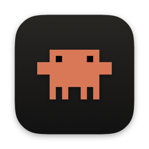
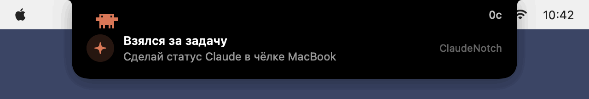
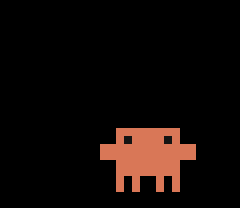
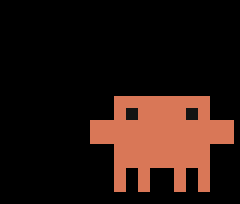
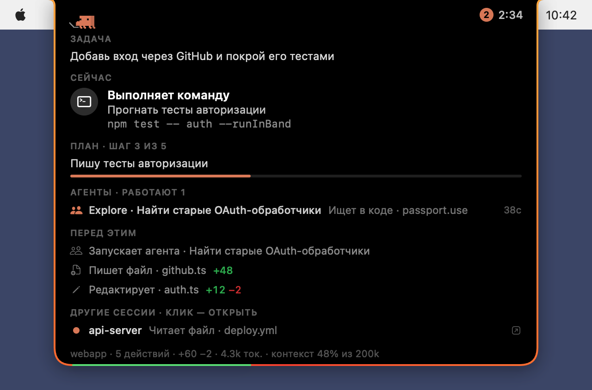
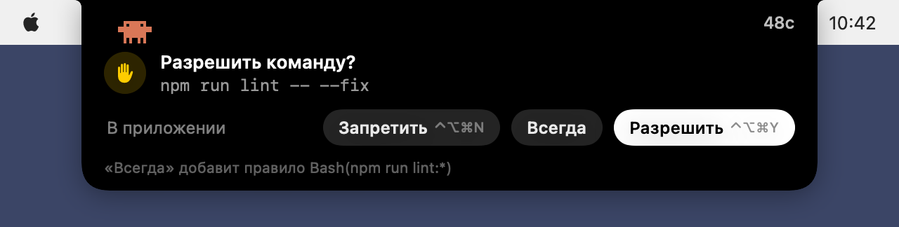
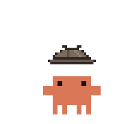
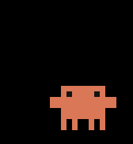
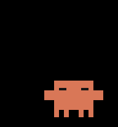

# Claude Notch

[English](README.md) · [Русский](README.ru.md)

<div align="center">



**[Claude Code](https://claude.com/claude-code) в чёлке MacBook — как Dynamic Island на iPhone.**<br>
Что Claude делает, сколько уже работает и когда ждёт тебя — и ответить ему можно прямо там.<br>
А ещё в чёлке живёт Clawd.



<table>
<tr>
<td align="center" valign="top"><br><b>Кофе</b></td>
<td align="center" valign="top"><br><b>Музыка</b></td>
<td align="center" valign="top"><br><b>Волшебство</b></td>
<td align="center" valign="top"><br><b>Блины</b></td>
</tr>
</table>

</div>

## Установка

Нужны macOS 14 или новее и Claude Code — в терминале или в приложении Claude.

1. Скачай **ClaudeNotch-….dmg** из [последнего релиза](https://github.com/CraftStick/ClaudeNotch/releases/latest) и открой Claude Notch прямо в нём. Apple его не нотаризовала, поэтому в первый раз macOS не откроет: нажми **Готово**, потом **Системные настройки → Конфиденциальность и безопасность → Всё равно открыть**.
2. Нажми **Переместить**: он скопирует себя в «Программы» и откроется оттуда.
3. Когда он спросит, подключиться ли к Claude Code, нажми **Подключить**. Он добавит свои хуки в `~/.claude/settings.json`, а исходный файл сохранит рядом.

**Или через [Homebrew](https://brew.sh):**

```bash
brew install craftstick/tap/claude-notch
```

Потом открой Claude Notch из Программ (в первый раз: **Готово**, потом **Системные настройки → Конфиденциальность и безопасность → Всё равно открыть**) и нажми **Подключить**. Обновление: `brew upgrade claude-notch`.

**Обновление:** открой новый прямо из образа диска и нажми **Переместить**: он закроет старый и встанет на его место.<br>
**Удаление:** перетащи приложение в Корзину и нажми **Удалить всё**: вместе с ним уйдут хуки, вход при запуске, настройки и данные.

<details>
<summary>Собрать из исходников</summary>

```bash
xcode-select --install   # инструменты разработчика Apple, если их ещё нет
git clone https://github.com/CraftStick/ClaudeNotch.git ~/ClaudeNotch
cd ~/ClaudeNotch && ./install.sh
```

`install.sh` собирает приложение в `/Applications` и добавляет хуки. Обновить — `git pull && ./install.sh`, удалить — `./uninstall.sh`, тесты — `swift test`.

</details>

## Что умеет

- **Статус в чёлке.** Слева Clawd, справа время задачи, а если сессий в работе несколько — их число. Чёлка раскрывается по важным поводам: новая задача, ошибка, Claude ждёт тебя, готово.
- **Только пока работает Claude Code.** Когда закрывается последняя сессия Claude Code — в терминале, редакторе или приложении Claude, — чёлка пустеет и значок Clawd в строке меню тоже уходит; со следующей сессией они возвращаются. Чтобы добраться до меню без Claude Code, открой Claude Notch ещё раз.
- **Подробности при наведении.** Задача, что Claude делает сейчас и зачем, его план, субагенты, последние действия, токены и контекст, другие сессии. Клик выводит вперёд вкладку терминала или приложение, где идёт сессия.
- **Ответы прямо из чёлки.** Разрешить или запретить действие (⌃⌥⌘Y / ⌃⌥⌘N, или **Всегда**) и выбрать ответ на вопрос Claude (⌃⌥⌘1…4).
- **Clawd.** Печатает, пока Claude работает, думает, машет, когда нужен ты, радуется, когда готово, и дремлет на отдыхе; пока Claude ищет, становится сыщиком, пока сжимает контекст — складывает бумаги в коробку, пока идёт сборка — помешивает в кастрюле, после пуша запускает ракету, а когда выполнен весь план — надевает академическую шапочку. Если включить **Clawd живёт в чёлке всегда**, он останется там насовсем и будет сам себя развлекать. [Все его анимации →](docs/clawd/README.ru.md)
- **Лимиты.** Когда закончился лимит сессии или недели, чёлка раскрывается: Clawd смотрит на песочные часы, а рядом написано, когда сброс. Лимит вернулся — Clawd подпрыгивает.
- **Telegram.** Подключи Mac к боту Claude Notch кодом из настроек и выбери, о чём он будет писать: лимит закончился или вернулся, Claude закончил, ждёт тебя или упёрся в ошибку API.
- Звук, когда Claude закончил или ждёт тебя, переливающаяся обводка, русский и английский, свои горячие клавиши, проверка обновлений по желанию. Всё это — в настройках: меню Clawd в строке меню → **Настройки…** (⌘,).

<p align="center"> </p>

## Знакомься, Clawd

Он живёт в чёлке и реагирует на всё, что делает Claude: больше 40 анимаций.

<table>
<tr>
<td align="center" valign="top" width="25%"><br><sub><b>Печатает, пока Claude работает</b></sub></td>
<td align="center" valign="top" width="25%"><br><sub><b>Думает</b></sub></td>
<td align="center" valign="top" width="25%"><br><sub><b>Становится сыщиком</b></sub></td>
<td align="center" valign="top" width="25%"><br><sub><b>Машет, когда нужен ты</b></sub></td>
</tr>
<tr>
<td align="center" valign="top" width="25%"><br><sub><b>Смущается от «спасибо»</b></sub></td>
<td align="center" valign="top" width="25%"><br><sub><b>Запускает ракету на push</b></sub></td>
<td align="center" valign="top" width="25%"><br><sub><b>Читает и засыпает</b></sub></td>
<td align="center" valign="top" width="25%"><br><sub><b>Танцует хулу</b></sub></td>
</tr>
</table>

<p align="center"><a href="docs/clawd/README.ru.md"><b>Все анимации Clawd →</b></a></p>

## Как это устроено

На каждое событие Claude Code запускает крошечный хук. Он передаёт событие приложению через локальный сокет, а на запрос разрешения или вопрос возвращает твой ответ. Ещё приложение читает файлы сессий в `~/.claude/projects`, чтобы заметить Esc и посчитать токены, и следит за списком запущенных сессий Claude Code в `~/.claude/sessions`, чтобы знать, когда он закрылся.

Всё о работе Claude остаётся на твоём Mac. В сеть приложение ходит только за тремя вещами. Чтобы следить за лимитами плана, оно спрашивает api.anthropic.com раз в несколько минут, пока Claude работает, и раз в 10 минут в остальное время (лимиты тратят и чаты, и другие устройства), входя как Claude Code и обновляя его вход, если тот устарел, как это делает сам Claude Code (выключается в настройках). Сообщения в Telegram, если подключить бота, идут через собственный [сервер](Server/) Claude Notch, который хранит только твой чат. И проверка обновлений на GitHub раз в день, если её включить. Пока чёлку не видно (дисплей спит, экран заблокирован), приложение просыпается только ради этой проверки лимитов; пока Claude работает, оно берёт около 1–2% одного ядра.

## Если что-то не работает

- **Чёлка не реагирует:** проверь, что в настройках включено **Подключено к Claude Code**. Сессии, открытые раньше, может понадобиться перезапустить.
- **Клик открывает терминал, но не ту вкладку:** разреши Claude Notch в Системных настройках → Конфиденциальность и безопасность → Автоматизация.
- **Что доходит до приложения:** `tail -f ~/Library/Application\ Support/ClaudeNotch/events.log`.

## Идеи

Есть идея, что добавить, или что-то не работает? [Напиши в issue](https://github.com/CraftStick/ClaudeNotch/issues/new) — расскажи об этом.

## Про Clawd

Clawd — персонаж Anthropic, и его спрайтов в этом репозитории нет: приложение берёт их из установленного у тебя Claude.app, а без него рисует упрощённого Clawd. Проект не связан с Anthropic и не одобрен ей.

[Лицензия PolyForm Strict 1.0.0](LICENSE) — для всех версий, включая 0.1.0–0.2.5: пользоваться Claude Notch можно в любых некоммерческих целях и бесплатно делиться его копиями без изменений, но нельзя менять его код или делать на его основе свои работы.
