[English](README.md) · **Русский**

# Clawd в чёлке

Все анимации Clawd в чёлке и когда они играют. Clawd — талисман Claude от Anthropic. Claude Notch не хранит его спрайты у себя: он читает их при запуске из настольного приложения Claude (без него вместо Clawd — упрощённый нарисованный). Эти GIF нарисованы тем же кодом анимации, что и в приложении, так что в чёлке всё выглядит точно так же.

[← Назад к README](../../README.ru.md)

## За работой

Clawd показывает, чем занят Claude, чтобы это было видно с одного взгляда.

<table>
<tr>
<td align="center" valign="top" width="25%"> <b>Лампочка</b> Пришла новая задача</td>
<td align="center" valign="top" width="25%"> <b>Печатает на ноутбуке</b> Claude работает</td>
<td align="center" valign="top" width="25%"> <b>Садится подумать</b> 12+ секунд без действий</td>
<td align="center" valign="top" width="25%"> <b>Пересаживается за компьютер</b> Команда идёт дольше 8 секунд</td>
</tr>
<tr>
<td align="center" valign="top" width="25%">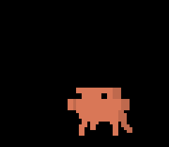 <b>Бегает</b> Работают субагенты или много действий подряд</td>
<td align="center" valign="top" width="25%"> <b>Становится сыщиком</b> Поиск по коду, файлам или в сети</td>
<td align="center" valign="top" width="25%">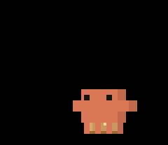 <b>Складывает бумаги в коробку</b> Сжатие контекста</td>
<td align="center" valign="top" width="25%">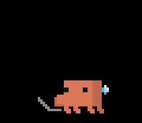 <b>Потеет</b> Контекст заполнен на 85%</td>
</tr>
</table>

## Ждёт тебя

Когда Claude нужен ответ, разрешение или одобрение плана.

<table>
<tr>
<td align="center" valign="top" width="25%"> <b>Машет тебе</b> Claude ждёт тебя</td>
<td align="center" valign="top" width="25%">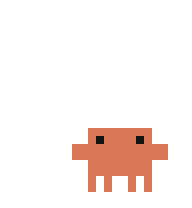 <b>Ищет тебя глазами</b> Ждёт больше минуты</td>
<td align="center" valign="top" width="25%"> <b>Садится ждать</b> Ждёт больше пяти минут</td>
<td align="center" valign="top" width="25%"> <b>Палец вверх и подмигивает</b> Ты разрешил действие</td>
</tr>
</table>

## Как он принимает твои слова

<table>
<tr>
<td align="center" valign="top" width="25%"> <b>Смущается, сердечко</b> Ты пишешь «спасибо»</td>
<td align="center" valign="top" width="25%"> <b>Вздрагивает</b> Капс, мат, «wtf»</td>
<td align="center" valign="top" width="25%"> <b>Потягивается и зевает</b> Первая задача за день</td>
<td align="center" valign="top" width="25%">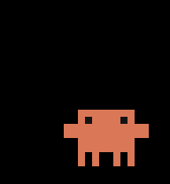 <b>Радуется</b> «Всегда» или ответ на вопрос</td>
</tr>
</table>

## Как идёт работа

Короткие реакции поверх того, чем Clawd был занят.

<table>
<tr>
<td align="center" valign="top" width="25%"> <b>Удивляется</b> Огромный вывод или файл</td>
<td align="center" valign="top" width="25%"> <b>Выдыхает «фух»</b> Заработало после ошибок</td>
<td align="center" valign="top" width="25%"> <b>Рука-лицо</b> Инструмент упал или ты отказал</td>
<td align="center" valign="top" width="25%"> <b>Вешает голову</b> Третья ошибка подряд</td>
</tr>
<tr>
<td align="center" valign="top" width="25%">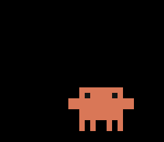 <b>Пожимает плечами</b> Авторежим запретил действие</td>
<td align="center" valign="top" width="25%"> <b>Зажигает бенгальский огонь</b> Тесты прошли</td>
<td align="center" valign="top" width="25%"> <b>Запускает ракету</b> git push прошёл</td>
<td align="center" valign="top" width="25%">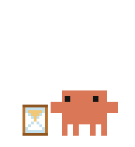 <b>Ждёт у песочных часов</b> Лимит запросов</td>
</tr>
</table>

## Конец задачи

<table>
<tr>
<td align="center" valign="top" width="25%">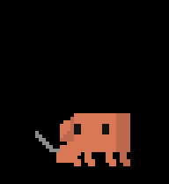 <b>Подпрыгивает от радости</b> Claude закончил</td>
<td align="center" valign="top" width="25%"> <b>Конфетти и брейк</b> Большая задача: 5+ минут или 150+ строк</td>
<td align="center" valign="top" width="25%"> <b>Гордится</b> Добавлено 300+ строк</td>
<td align="center" valign="top" width="25%"> <b>Подметает</b> Кода удалено больше, чем добавлено</td>
</tr>
<tr>
<td align="center" valign="top" width="25%">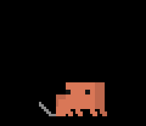 <b>Поворачивается и слушает</b> Ты остановил Claude через Esc</td>
<td align="center" valign="top" width="25%"> <b>Кружится голова</b> Ошибка API</td>
</tr>
</table>

## Ночью

С полуночи до 6 он работает в ночном колпаке: достаёт его из-за спины и потом убирает обратно, а кофе у него — чай.

<table>
<tr>
<td align="center" valign="top" width="25%"> <b>Надевает колпак</b> Работа началась ночью</td>
<td align="center" valign="top" width="25%">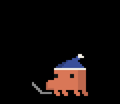 <b>Иногда зевает</b> За работой с 1 до 5 ночи</td>
</tr>
</table>

## Отдых

После задачи Clawd остаётся в чёлке ещё 15 минут, чтобы было видно, что Claude закончил. Раз в 30 секунд он делает одно из этого, не два раза подряд одно и то же, а в промежутках дышит, моргает и поглядывает по сторонам.

<table>
<tr>
<td align="center" valign="top" width="25%"> <b>Оглядывается</b></td>
<td align="center" valign="top" width="25%"> <b>Покачивается</b></td>
<td align="center" valign="top" width="25%"> <b>Танцует</b></td>
<td align="center" valign="top" width="25%"> <b>Танцует хулу</b> В юбке, которую достаёт из-за спины</td>
</tr>
<tr>
<td align="center" valign="top" width="25%"> <b>Читает и засыпает под книгой</b> Через 3 минуты после задачи</td>
<td align="center" valign="top" width="25%">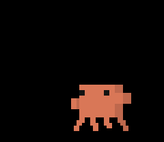 <b>Уходит</b> Через 15 минут; чёлка прячется</td>
</tr>
</table>

## Живёт в чёлке всегда

Включи в настройках (меню Clawd → Настройки…) **Clawd живёт в чёлке всегда**: он спустится на парашюте и больше не уйдёт. Когда у Claude нет дел, Clawd сам находит себе занятие, и ничего не повторяется, пока не пройдут шесть других.

<table>
<tr>
<td align="center" valign="top" width="25%"> <b>Кофе</b></td>
<td align="center" valign="top" width="25%"> <b>Музыка</b></td>
<td align="center" valign="top" width="25%"> <b>Волшебство</b></td>
<td align="center" valign="top" width="25%"> <b>Блины</b></td>
</tr>
<tr>
<td align="center" valign="top" width="25%"> <b>Кружится голова</b> Ткни в него четыре раза за три секунды</td>
</tr>
</table>

## Реквизит
Ничего не появляется из воздуха: книжку, кружку, шляпы, метлу, ракету он достаёт из-за спины и туда же убирает. А если приходит задача, пока он чем-то занят, он сначала всё убирает и только потом берётся за работу.

Реквизит нарисован в коде Claude Notch поверх собственных кадров Clawd из приложения Claude.
